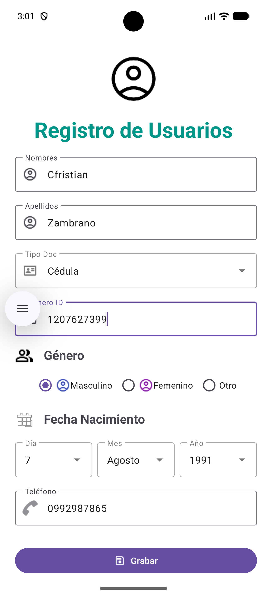

# Práctica 2 - UI ITAB

Esta es una aplicación de Android que implementa un formulario de **Registro de Usuarios** utilizando `ConstraintLayout` y `ScrollView` para manejar el diseño de manera responsiva.

  

## Características

La interfaz de usuario ha sido construida utilizando componentes de Material Design (`TextInputLayout` con estilo *Outline*) e incluye los siguientes campos:

- **Nombres y Apellidos**: Campos de texto estándar para información personal.
- **Tipo de Documento**: Menú desplegable (*Exposed Dropdown Menu*) con opciones predefinidas (Cédula, Pasaporte, RUC).
- **Número ID**: Campo de texto numérico para el documento.
- **Género**: Grupo de botones de radio (`RadioGroup`) para seleccionar Masculino, Femenino u Otro.
- **Fecha de Nacimiento**: Diseño en línea (`LinearLayout` horizontal) que incluye tres menús desplegables independientes para seleccionar el Día, Mes y Año.
- **Teléfono**: Campo de texto numérico para el número de contacto.
- **Botón Grabar**: Botón principal de acción en la parte inferior.

## Detalles Técnicos

- **Diseño de Interfaz**: Construido íntegramente en XML (`activity_main.xml`).
- **Layouts Principales**: 
  - `ScrollView` para permitir desplazamiento en dispositivos pequeños.
  - `ConstraintLayout` para organizar los elementos relativos entre sí.
- **Recursos (Resources)**: Los datos de los selectores (Días, Meses, Años, Tipo de documento) están centralizados mediante etiquetas `<string-array>` en el archivo `strings.xml`.
